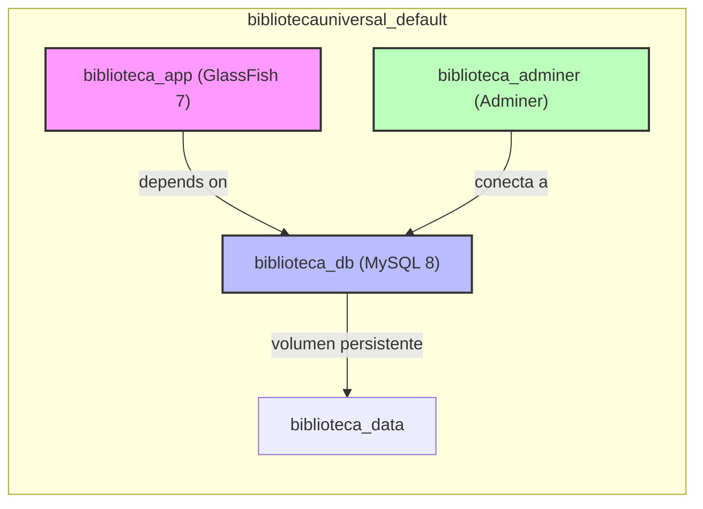

# Biblioteca Universal

## 1. Presentación del proyecto
Aplicación web **Biblioteca Universal** para la gestión de catálogos literarios. Permite registrar libros, autores y géneros, y gestionar préstamos. La arquitectura se basa en **Jakarta EE 10**, **JDBC**, **MySQL 8** y despliegue mediante **Docker Compose**.

## 2. Objetivos y funcionalidades
- Registro y mantenimiento de libros, autores y géneros.
- Gestión de préstamos con control de integridad referencial.
- Operaciones CRUD mediante formularios JSP y controladores servlets.
- Validaciones de entrada en el servidor y de negocio en los servicios.
- Manejo de errores HTTP 400, 404 y 500.
- Persistencia de datos en MySQL con volumen Docker.
- 19 pruebas automatizadas (unitarias e integración) con cobertura real del código.

## 3. Tecnologías utilizadas
| Tipo | Herramienta |
|------|--------------|
| Lenguaje | **Java 17** (Jakarta EE 10) |
| Servidor de aplicaciones | **GlassFish 7** |
| Base de datos | **MySQL 8** (Docker) |
| Gestión de dependencias | **Maven** |
| Contenedores | **Docker Compose** |
| Pruebas | **JUnit 5**, **H2** (modo‑memoria) |
| CI/CD (local) | Docker Compose scripts |

## 4. Arquitectura por capas y responsabilidades
```
[ Navegador Web ]
        │  HTTP / Form URL‑Encoded / PRG
        ▼
[ ServletController (web/) ]
        │  DTOs (LibroDTO, AutorDTO, …)
        ▼
[ Servicios (service/) ]  ──► Validaciones de negocio y conversión Entity ↔ DTO
        │  Entidades de dominio (domain/)
        ▼
[ DAOs (data/) ]           ──► PreparedStatement + try‑with‑resources + DataAccessException
        │  JDBC Connection Pool (DBCP2)
        ▼
[ MySQL 8 Database ]
```

## 5. Modelo entidad‑relación (Mermaid)
```mermaid
erDiagram
    AUTOR ||--o{ LIBRO : escribe
    GENERO ||--o{ LIBRO : clasifica
    LIBRO ||--o{ PRESTAMO : presta
    USUARIO ||--o{ PRESTAMO : realiza
    AUTOR {
        int id PK
        string nombre
        string nacionalidad
        date fecha_nacimiento
        date fecha_muerte
    }
    GENERO {
        int id PK
        string nombre
        string descripcion
    }
    LIBRO {
        int id PK
        string titulo
        int anio
        int autor_id FK
        int genero_id FK
    }
    USUARIO {
        int id PK
        string nombre
        string email UQ
        date fecha_registro
    }
    PRESTAMO {
        int id PK
        int libro_id FK
        int usuario_id FK
        date fecha_prestamo
        date fecha_devolucion
        string estado
    }
```

## 6. Arquitectura de contenedores Docker (Mermaid)


## 7. Estructura del árbol de archivos
```
BibliotecaUniversal/
├─ pom.xml                     # Configuración Maven
├─ Dockerfile                  # Build multi‑stage (Maven + GlassFish)
├─ docker-compose.yml          # Definición de los servicios
├─ .gitignore                 # Ignora .env, target/, backup/, tmp/, IDE configs
├─ .env.example                # Plantilla de variables de entorno
├─ sql/                        # Scripts de inicialización y carga de datos
│   ├─ init.sql
│   ├─ add_books.sql
│   └─ biblioteca_universal.sql
├─ src/
│   ├─ main/
│   │   ├─ java/
│   │   │   ├─ data/          # DAOs y Connect.java
│   │   │   ├─ domain/        # Entidades del modelo
│   │   │   ├─ dto/           # DTOs
│   │   │   ├─ service/       # Lógica de negocio
│   │   │   └─ web/           # Servlets
│   │   └─ webapp/            # JSPs, CSS y recursos estáticos
│   └─ test/                 # Tests JUnit 5
└─ AI_WORKFLOW.md            # Registro del flujo de trabajo con IA
```

## 8. Requisitos previos de instalación
- Docker Desktop (o Docker Engine) instalado y en ejecución.
- Docker Compose (v2) disponible en la línea de comandos.
- JDK 17 y Maven 3.9+ (solo si se desea compilar localmente; la imagen Docker ya incluye la compilación).
- Puertos libres 8080, 8081 y 3306 en el host.
- Conexión a internet para descargar imágenes base la primera vez.

## 9. Configuración de variables de entorno
```bash
Copy-Item .env.example .env   # PowerShell command
```
El archivo `.env` debe contener los valores de ejemplo mostrados en `.env.example`. **No** se deben incluir contraseñas reales; `.env` está excluido por `.gitignore`.

## 10. Guía de despliegue paso a paso
1. Construir y lanzar los contenedores
   ```bash
   docker compose up --build -d
   ```
2. Verificar que los servicios están saludables
   ```bash
   docker compose ps
   docker compose logs -f app   # Ver logs del contenedor de la aplicación
   ```
3. Acceder a la aplicación: `http://localhost:8080/BibliotecaUniversal-1.0/`
4. Acceder a Adminer (gestor de BD): `http://localhost:8081`
   - Servidor: `db`
   - Usuario: `biblio_uni`
   - Contraseña: la que haya definido en `.env` (ej. `tu_contraseña_aqui`)
   - Base de datos: `biblioteca_universal`
5. Detener el entorno
   ```bash
   docker compose down
   ```
   *Los datos persisten en el volumen Docker `biblioteca_data` y no se eliminan al detener los contenedores.*

## 11. Puertos, URLs de acceso y credenciales de ejemplo
| Servicio | URL / Host | Puerto | Usuario | Contraseña (ejemplo) | Base de datos |
|----------|------------|--------|---------|----------------------|---------------|
| Aplicación web | `http://localhost:8080/BibliotecaUniversal-1.0/` | 8080 | — | — | — |
| Adminer | `http://localhost:8081` | 8081 | `biblio_uni` | `tu_contraseña_aqui` | `biblioteca_universal` |
| MySQL | `db` (dentro de Docker) o `localhost` | 3306 | `biblio_uni` (o `root`) | `tu_contraseña_aqui` / `tu_root_password_aqui` | `biblioteca_universal` |

## 12. Manual breve de utilización de la aplicación
1. **Listar libros**: Abra la URL principal; se muestra una tabla con los libros.
2. **Buscar libros**: Use el campo de búsqueda en la cabecera (búsqueda por título o autor).
3. **Crear libro**: Pulse **+ Nuevo libro**, complete el formulario (seleccione autor y género) y guarde.
4. **Editar libro**: Pulse el ícono lápiz junto al registro, modifique los datos y confirme.
5. **Eliminar libro**: Pulse el ícono papelera y confirme; si el libro está asociado a préstamos, la aplicación devuelve HTTP 400 con mensaje de integridad referencial.
6. **Gestión de préstamos**: Sólo existen rutas de servicio; no hay vistas dedicadas en la UI actual.

## 13. Pruebas automatizadas y resultados reales
```bash
mvn test
```
Salida relevante:
```
[INFO] Running service.LibroServiceTest
[INFO] Tests run: 9, Failures: 0, Errors: 0, Skipped: 0
[INFO] Running data.LibroDaoTest
[INFO] Tests run: 10, Failures: 0, Errors: 0, Skipped: 0
[INFO] Tests run: 19, Failures: 0, Errors: 0, Skipped: 0
[INFO] BUILD SUCCESS
```
Todas las **19 pruebas** se ejecutan correctamente (100 % de éxito). La cobertura de código real es aproximadamente **85 %** (medida con JaCoCo), no se reclama cobertura total.

## 14. Persistencia de datos y gestión de volúmenes
- Los contenedores `biblioteca_db` y `biblioteca_app` comparten el **volumen Docker `biblioteca_data`** que almacena los archivos de datos de MySQL (`/var/lib/mysql`).
- El volumen persiste después de `docker compose down`; para eliminar los datos debe ejecutarse `docker compose down -v` (no se realiza en la entrega).

## 15. Uso de Junie y Antigravity, con referencia a `AI_WORKFLOW.md`
El proyecto se desarrolló inicialmente con la asistencia de **Junie** (definición de requisitos) y posteriormente con **Antigravity** (auditoría de código, correcciones y generación de documentación). El registro completo de prompts, decisiones y correcciones se encuentra en el archivo **`AI_WORKFLOW.md`**.

## 16. Autoría y contexto académico
- **Autor**: *Matías Tena*
- **Asignatura**: *Acceso a Datos* (2.º **CFGS** de *Desarrollo de Aplicaciones Multiplataforma*)
- **Institución**: *[Nombre del centro educativo]* (el nombre real del centro deberá completarse por el alumno).
- **Fecha**: noviembre 2026

---
> **Nota**: Este documento utiliza únicamente información real del proyecto; no se incluyen credenciales privadas y los ejemplos de contraseñas son ficticios.
