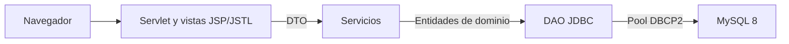
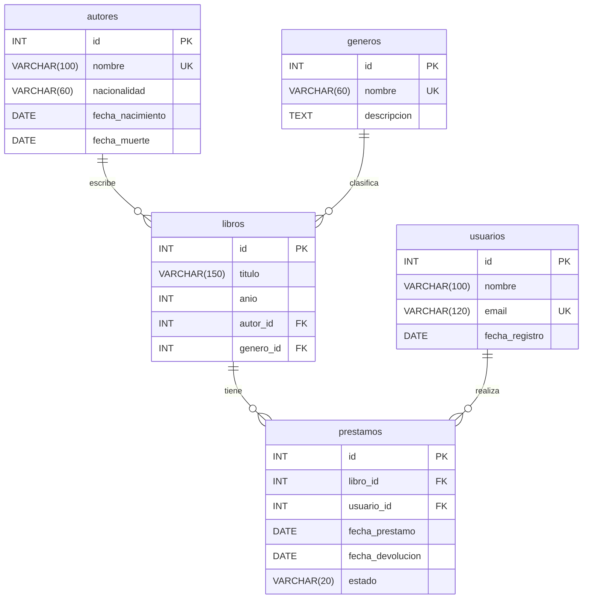
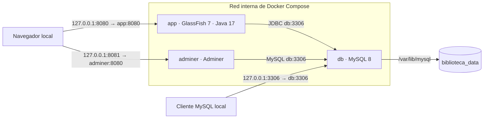

# Biblioteca Universal

Aplicación académica de gestión de un catálogo literario. Permite consultar, buscar, filtrar, crear, editar y eliminar libros. Autores y géneros alimentan los formularios y los filtros. Usuarios y préstamos forman parte del modelo de datos y de las capas Java. La interfaz se dedica al catálogo.

## Arquitectura

Java 17, Jakarta EE 10 y GlassFish 7 sirven la aplicación web. Maven genera el WAR. JSP y JSTL presentan los datos. El servlet valida la entrada HTTP, los servicios aplican las reglas de negocio y convierten entidades en DTO, y los DAO usan JDBC, consultas parametrizadas y un pool DBCP2 para acceder a MySQL 8. JUnit 5 y H2 permiten ejecutar las pruebas del servicio y de persistencia.



## Modelo entidad-relación

Las relaciones reflejan [sql/init.sql](sql/init.sql). Cada libro pertenece a un autor y a un género. Cada préstamo corresponde a un libro y un usuario. Las claves foráneas son obligatorias y usan `ON DELETE RESTRICT` y `ON UPDATE CASCADE`.



## Arquitectura de contenedores



Compose monta `sql/init.sql` en modo de solo lectura. MySQL ejecuta el script al inicializar un volumen vacío con la base indicada por `DB_NAME`. Las actualizaciones de la aplicación conservan la base existente. Se puede pausar el entorno con `docker compose stop` y reanudarlo con `docker compose start`.

## Estructura

```text
BibliotecaUniversal/
├── .env.example
├── .gitignore
├── Dockerfile
├── docker-compose.yml
├── pom.xml
├── sql/                     # init.sql y scripts auxiliares
├── src/main/java/           # web, service, dto, domain y data
├── src/main/webapp/         # JSP y CSS
├── src/test/java/           # JUnit 5
├── README.md
└── AI_WORKFLOW.md
```

## Requisitos y clonación

Instala Git, Docker y Docker Compose. Inicia el motor de Docker y comprueba que los puertos 8080, 8081 y 3306 estén libres. Para compilar fuera de Docker, instala JDK 17 y Maven 3.9.

```powershell
git clone https://github.com/matiastenam-rgb/Biblioteca-Universal.git
cd Biblioteca-Universal/BibliotecaUniversal
Copy-Item .env.example .env
```

En Bash, usa `cp .env.example .env` para crear la configuración. Si el entorno ya tiene un `.env`, reutilízalo. El archivo está excluido por Git.

| Variable en `.env` | Ejemplo | Función |
|---|---|---|
| `DB_HOST` | `localhost` | Servidor que se exporta al proceso de GlassFish si se ejecuta fuera de Compose. |
| `DOCKER_DB_HOST` | `db` | Compose lo pasa como `DB_HOST` dentro del contenedor de la aplicación. `db` es el nombre del servicio MySQL. |
| `DB_PORT` | `3306` | Puerto JDBC. En Compose es el puerto interno de MySQL. |
| `DB_NAME` | `biblioteca_universal` | Base usada por JDBC y variable `MYSQL_DATABASE` al inicializar MySQL. |
| `DB_USER` | `biblio_uni` | Usuario JDBC y valor de `MYSQL_USER` para inicializar la cuenta de aplicación. |
| `DB_PASS` | `ejemplo_biblio_local` | Contraseña de ejemplo de esa cuenta. Compose la pasa también como `MYSQL_PASSWORD`. |
| `MYSQL_ROOT_PASSWORD` | `ejemplo_root_local` | Contraseña ficticia de administración para inicializar MySQL. |

GlassFish fuera de Compose lee las variables del entorno del proceso. Editar `.env` por sí solo no las exporta. Para un volumen ya inicializado, los valores de conexión deben coincidir con las cuentas y la base de datos existentes.

## Despliegue

Ejecuta estos comandos desde el directorio que contiene `docker-compose.yml`.

```powershell
docker compose config --quiet
docker compose up --build -d
docker compose ps
docker compose logs --tail 50 app db
```

| Servicio | Acceso desde el host | Credenciales de prueba |
|---|---|---|
| Aplicación | [Biblioteca Universal](http://localhost:8080/BibliotecaUniversal-1.0/) | Acceso local directo |
| Adminer | [Adminer](http://localhost:8081/) | Sistema MySQL, servidor `db`, usuario `biblio_uni`, contraseña `ejemplo_biblio_local`, base `biblioteca_universal` |
| MySQL | `127.0.0.1:3306` | La misma cuenta de ejemplo. El usuario administrador de inicialización es `root`, con contraseña ficticia `ejemplo_root_local`. |

## Manual

1. Abre el catálogo y consulta los totales de libros, autores y géneros.
2. Introduce parte del título o del nombre del autor. Puedes combinar el texto con uno o ambos selectores. **Limpiar** restaura el catálogo y **Anterior** y **Siguiente** conservan los filtros.
3. Pulsa **Nuevo libro** y completa título, autor, género y año. El año admite valores negativos para obras anteriores a la era común.
4. Usa **Editar** para abrir un registro. **Cancelar** vuelve al catálogo. Los errores de validación se muestran en el formulario.
5. Usa **Eliminar** y confirma la operación. MySQL impide borrar libros con préstamos asociados. El catálogo muestra el resultado de la operación.

## Pruebas

```powershell
mvn clean verify
```

Maven ejecuta JUnit 5 y genera `target/BibliotecaUniversal-1.0.war`. Los informes por suite se guardan en `target/surefire-reports/`. H2 ejecuta las pruebas del DAO y los servicios con una base de datos de prueba. El despliegue con MySQL se comprueba de forma independiente.

## Resolución de problemas

| Síntoma | Comprobación |
|---|---|
| HTTP 404 al abrir la aplicación | Usa el contexto `/BibliotecaUniversal-1.0/` y revisa los mensajes de despliegue en `docker compose logs app`. |
| MySQL todavía no está listo | Consulta `docker compose ps` y `docker compose logs db`. La aplicación depende del estado saludable de `db`. |
| Error de credenciales | Compara las variables con la cuenta real de MySQL. Cambiar `.env` no cambia las cuentas del volumen existente. |
| Puerto ocupado | Identifica el proceso que ocupa el puerto antes de arrancar Compose. Los puertos internos y externos se documentan en el diagrama. |
| Caracteres incorrectos en un título existente | Comprueba el valor almacenado y corrige el título desde el formulario tras confirmar el texto original. |

## Autoría

Matías Tena · Acceso a Datos · 2.º de Desarrollo de Aplicaciones Multiplataforma. El historial de asistencia de IA está en [AI_WORKFLOW.md](AI_WORKFLOW.md).
